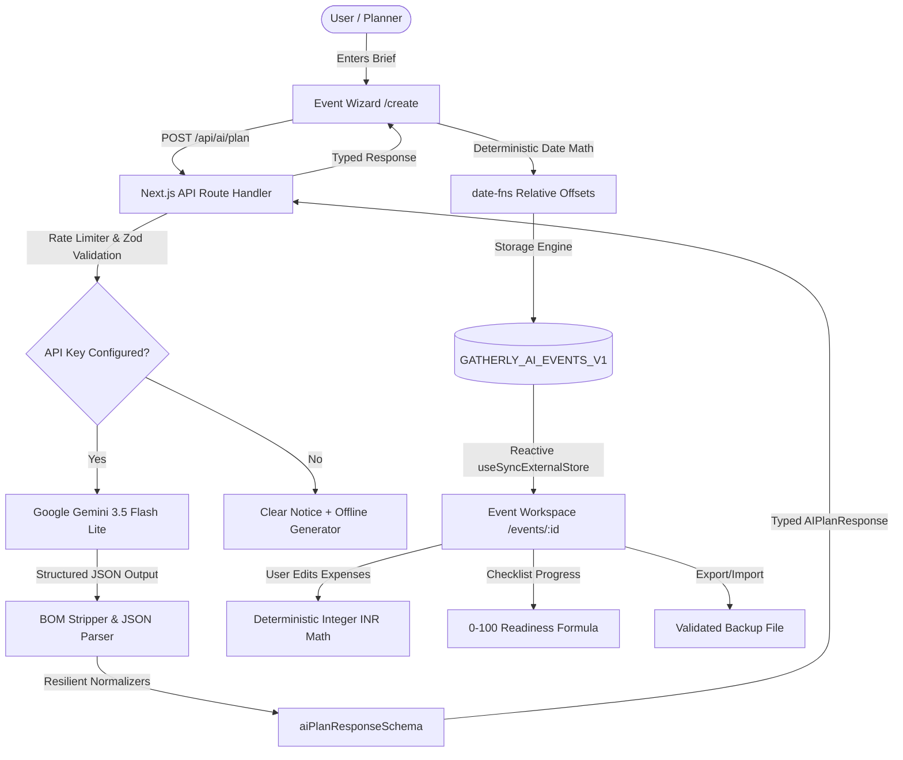

# Gatherly AI — Every celebration, thoughtfully planned.

> **PromptWars Virtual — Challenge 5: Celebration & Event Planner Submission**  
> AI-powered celebration and event planning workspace for Indian and global events (weddings, milestone birthdays, anniversaries, college fests, cultural festivals, corporate galas, and community gatherings).

---

## 1. Problem Statement
Planning celebrations demands coordinating complex, fragmented logistics:
- **Tight Budget Discipline**: Hidden costs, unclear category splits, and disconnected vendor quotes lead to stress and overspending.
- **Cultural Nuances**: Regional Indian catering requirements (e.g., pure vegetarian, live chaat counters, regional delicacies), auspicious timings, and venue constraints.
- **Scattered Deadlines**: Task deadlines spread across WhatsApp messages, spreadsheets, notes, and emails.
- **Uncontrolled Chatbot Text**: Generic chatbots dump unstructured walls of text that cannot be edited, tracked, or exported into actionable workflows.

**Gatherly AI** solves this by turning user celebration requirements into an actionable, editable, offline-first workspace with deterministic budgeting, relative checklist scheduling, vendor tracking, curated ideas, and a transparent readiness score.

---

## 2. Key Features & Highlights

- **Structured AI Generation**: Powered by Google's official Gemini API (`@google/genai`) using **`gemini-3.5-flash-lite`** (with `gemini-3.1-flash-lite` fallback) for rapid, structured JSON schema outputs.
- **Support for All Celebration Types**: Handles standard and custom categories including Weddings, Milestone Birthdays, Anniversaries, **College Fests / Cultural Events**, Corporate Galas, Baby Showers, Housewarmings, Hackathons, and Community Gatherings.
- **Resilient AI Output Normalization**: Intelligent preprocessing automatically maps festival-specific AI terms (e.g., stage lighting, sound engineering, security, permits, urgent priority) into domain categories without breaking schema validation.
- **Deterministic INR Budget Engine**: Zero floating-point math drift. Real-time integer INR calculations for total budget, committed spend, remaining buffer, category splits, and payment tracking using `Intl.NumberFormat('en-IN')`.
- **Timeline & Relative Checklist**: Converts AI relative integer day offsets into calendar deadlines using `date-fns`. Tracks overdue tasks, upcoming milestones, and predecessor task dependencies.
- **Vendor Negotiation Pipeline**: Categorized partner tracker (Venue, Catering, Decor, Photography, Entertainment, Transport, Rentals) with booking status, quotation notes, and tailored questions to ask before booking.
- **Curated Ideas & Risk Contingencies**: Culturally grounded themes, harmonized color palettes, interactive party experiences, and practical risk mitigations (such as outdoor weather rain backup).
- **Transparent Event Readiness Score (0-100)**: Multi-factor mathematical formula based on actual application state:
  - Checklist execution (40%)
  - Vendor pipeline readiness (25%)
  - Budget discipline (20%)
  - Risk & contingency planning (15%)
- **Offline-First & Local Storage (`GATHERLY_AI_EVENTS_V1`)**: 100% private client-side persistence using React 19's `useSyncExternalStore` with real-time multi-tab synchronization.
- **Robust JSON Backup Import & Export**: One-click export and import of plan backups. Supports UTF-8 BOM stripping, storage wrapper unwrapping (`{ version: 1, events: [...] }`), array imports, and duplicate ID disambiguation.
- **Print / PDF Agenda View**: Clean `@media print` CSS stylesheet designed for physical vendor handouts.
- **Graceful Demo Fallback**: Built-in 60-guest, ₹40,000 Bhopal rooftop 30th birthday demo plan and an instant offline plan generator when `GEMINI_API_KEY` is not present.

---

## 3. Technology Stack

- **Framework**: Next.js 16 (App Router)
- **UI & State**: React 19, TypeScript (Strict Mode), `useSyncExternalStore`
- **Styling**: Tailwind CSS with custom warm ivory (`#FAF7F2`), ink forest text (`#182620`), sage green (`#2D5A43`), and warm coral (`#C85A32`) palette
- **Forms & Validation**: `react-hook-form` + `zod`
- **Date Arithmetic**: `date-fns`
- **AI Integration**: Google `@google/genai` (**`gemini-3.5-flash-lite`** default, **`gemini-3.1-flash-lite`** fallback) with structured JSON schemas
- **Testing**: `vitest`, `jsdom`, `@testing-library/react` (48 automated tests across 10 test files)
- **Icons & Polish**: `lucide-react`, `canvas-confetti`

---

## 4. Architecture & Data Flow



---

## 5. Recent Fixes & Improvements

1. **AI Model Compatibility & Modernization**:
   - Replaced deprecated `gemini-2.5-flash` (retired for new Google AI Studio accounts with 404 errors) with **`gemini-3.5-flash-lite`**.
   - Added automatic fallback to `gemini-3.1-flash-lite` if the primary model encounters a temporary 503 high-demand spike.
   - Built a standalone verification script (`scripts/verify-gemini.mjs`) callable via `npm run verify:api`.

2. **Custom Event Types Support (e.g., College Fests & Hackathons)**:
   - Updated `aiPlanRequestSchema` and `createEventFormSchema` with `flexibleEventTypeSchema` (`z.string().trim().min(1).max(80)`).
   - Created resilient category normalizers (`normalizeVendorCategory`, `normalizeTaskCategory`, `normalizeIdeaCategory`) that map domain terms (e.g. concert audio, security bouncers, crowd permits) into application categories without failing validation.
   - Loosened AI output schema string length limits to accommodate rich generation outputs.

3. **JSON Backup Import / Export Engine**:
   - Fixed native file picker trigger in the dashboard UI using `useRef` directly on the file input instead of nesting inside `<label>`.
   - Added JSON Import trigger to the dashboard empty state.
   - Enhanced `importEventFromJSON` to strip Windows UTF-8 BOM (`\uFEFF`) and support direct plan objects, multi-event arrays, and full storage wraps (`{ version: 1, events: [...] }`).

4. **Next.js & Vitest Tooling Compatibility**:
   - Resolved Vite/Vitest plugin overload type mismatch in `vitest.config.ts`.
   - Resolved Next.js 16 hydration warning via `suppressHydrationWarning` on `<body>`.

---

## 6. Local Setup Instructions

### Prerequisites
- Node.js 18+ (verified on Node.js v24.20.0)
- npm 10+ (verified on npm 11.19.0)

### 1. Clone & Install
```bash
git clone https://github.com/Deepcode2021/Gatherly-AI
cd gatherly-ai
npm install
```

### 2. Configure Environment Variables
Copy the example environment file:
```bash
cp .env.example .env.local
```
Add your Google Gemini API key obtained from [Google AI Studio](https://aistudio.google.com/):
```env
GEMINI_API_KEY=your_gemini_api_key_here
GEMINI_MODEL=gemini-3.5-flash-lite
```
*(Note: If no key is configured, Gatherly AI runs in Demo Mode with full workspace functionality and offline generation).*

### 3. Verify API Key (Optional)
```bash
npm run verify:api
```

### 4. Run Development Server
```bash
npm run dev
```
Open [http://localhost:3000](http://localhost:3000) in your browser.

---

## 7. Verification & Test Commands

Every feature in Gatherly AI is strictly verified through automated test suites:

```bash
# 1. Run all unit, integration, and import tests (48 tests passing)
npm run test

# 2. Run TypeScript strict typecheck (0 errors)
npm run typecheck

# 3. Run ESLint (0 errors)
npm run lint

# 4. Run Next.js production build
npm run build
```

---

## 8. Deployment Instructions (Vercel)

Gatherly AI is built for frictionless deployment to Vercel:

1. Push your repository to GitHub.
2. In the [Vercel Dashboard](https://vercel.com/new), select **Import Project** and link your repository.
3. In **Environment Variables**, add:
   - `GEMINI_API_KEY`: Your Google Gemini API key.
   - `GEMINI_MODEL`: `gemini-3.5-flash-lite` (or your preferred model).
4. Deploy. Vercel automatically runs `npm run build` and serves static routes at the edge with serverless route handlers for `/api/ai/plan`.

---

## 9. Limitations and Future Scope

- **Process-Local Rate Limiting**: The current `/api/ai/plan` endpoint uses in-memory IP rate limiting (10 requests/minute). In globally distributed multi-region serverless deployments, this can be upgraded to Upstash Redis.
- **Collaborative Real-Time Sync**: Version 1 stores plans locally in `localStorage` for privacy and offline reliability. Future versions will support optional peer-to-peer cloud sync via WebSockets / CRDTs.
- **Live Vendor Marketplace**: Current vendor listings are curated placeholders with smart inquiry questions; future releases will integrate verified WhatsApp Business vendor directories.
