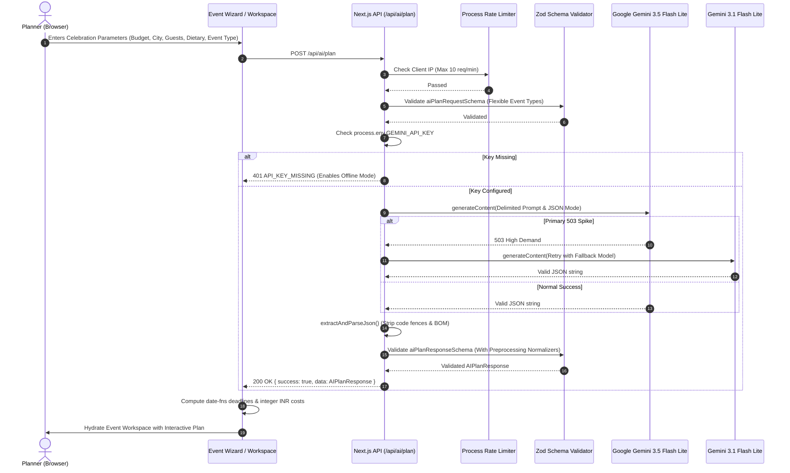

# Gatherly AI — System Architecture & Technical Design

## 1. Architectural Philosophy
Gatherly AI is built around four foundational architectural principles:
1. **Deterministic Application Logic**: AI is used strictly for creative blueprint synthesis and ideation. All financial math, budget aggregations, overdue calculations, and readiness scores are deterministic, pure TypeScript functions.
2. **Offline-First Resilience**: Celebration coordinators often operate in banquet basements or outdoor garden areas with unreliable mobile connectivity. All application state is stored locally in versioned `localStorage` with JSON export/import and fallback offline generation.
3. **Structured Interface Data Over Chatbot Text**: Rather than dumping unstructured conversational paragraphs, AI responses conform to strict JSON schemas that immediately hydrate interactive UI components (tables, progress bars, checklists, vendor pipelines).
4. **WCAG 2.2 AA Accessibility & Polish**: Warm celebratory design system with high-contrast typography, clear keyboard focus indicators, semantic landmarks, and full mobile responsiveness.

---

## 2. Directory & Component Hierarchy

```
gatherly-ai/
├── scripts/
│   └── verify-gemini.mjs             # Diagnostic CLI script for testing Gemini model connectivity
├── src/
│   ├── app/                          # Next.js App Router
│   │   ├── api/ai/plan/route.ts      # Server-side Gemini AI generation endpoint (Rate limited, Zod validated)
│   │   ├── create/page.tsx           # Multi-step Event Creation Wizard with quick presets
│   │   ├── dashboard/page.tsx        # Workspace Dashboard, metrics summary, & backup import/export
│   │   ├── events/[id]/page.tsx      # 5-Tab Event Workspace (Overview, Budget, Timeline, Vendors, Ideas)
│   │   ├── globals.css               # Design system tokens & print styles
│   │   ├── layout.tsx                # Root layout with Navbar, Footer, and typography
│   │   └── page.tsx                  # Landing page with interactive preview card
│   ├── components/
│   │   ├── layout/                   # Navbar & Footer
│   │   └── ui/                       # Reusable accessible UI primitives (Button, Card, Badge, Dialog, ProgressBar)
│   ├── lib/
│   │   ├── gemini.ts                 # Server-side Google Gemini client (gemini-3.5-flash-lite + fallback)
│   │   └── __tests__/
│   │       └── gemini.test.ts        # Unit tests for prompt engine, JSON parser, & response normalization
│   ├── types/
│   │   ├── event.ts                  # Strict domain models (EventPlan, BudgetItem, TaskItem, VendorItem)
│   │   └── schemas.ts                # Zod validation schemas with resilient preprocessors
│   └── utils/
│       ├── budget.ts                 # Deterministic integer INR budget engine
│       ├── demoEvent.ts              # Bundled Bhopal 30th birthday celebration plan
│       ├── formatters.ts             # Indian currency (₹) & date formatting
│       ├── offlineGenerator.ts       # Template engine for offline/demo plan synthesis
│       ├── readiness.ts              # 0-100 Event Readiness Score algorithm
│       ├── storage.ts                # Versioned localStorage (GATHERLY_AI_EVENTS_V1) & backup I/O
│       ├── useEvents.ts              # React 19 useSyncExternalStore custom hooks
│       └── __tests__/                # Vitest test suites (storage, timeline, readiness, budget, formatters)
```

---

## 3. AI Request Lifecycle & Prompt Safety



### Prompt Safety & Delimitation
- User-supplied inputs are isolated within explicit delimiters (`<<<EVENT_TITLE>>>`, `<<<EVENT_TYPE>>>`, `<<<ADDITIONAL_NOTES>>>`).
- Explicit instructions mandate that user text cannot redefine JSON schema constraints or budget ceilings.
- Payloads exceeding 50KB are rejected before reaching the AI.
- AI operations are bounded by a 40-second timeout promise race.

---

## 4. Resilient Category Normalization Layer

When users plan non-traditional celebrations (such as college fests, cultural competitions, or hackathons), AI models naturally introduce domain-specific taxonomy. Rather than failing schema validation with a 500 error, Gatherly AI incorporates intelligent Zod preprocessing normalizers:

| Category Scope | AI Terms Handled | Mapped Domain Category |
|---|---|---|
| **Vendors & Budget** | "concert sound", "line array", "dj", "band", "stage audio" | `entertainment` |
| **Vendors & Budget** | "stage design", "lighting rig", "moving heads", "flower backdrop" | `decoration` |
| **Vendors & Budget** | "campus food trucks", "mocktails", "beverage stalls", "catering" | `catering` |
| **Vendors & Budget** | "shuttle buses", "equipment travel", "cab transfers" | `transport` |
| **Vendors & Budget** | "canopy truss", "furniture hire", "generator rental" | `rentals` |
| **Tasks** | "police permits", "campus safety", "bouncers", "medical booth" | `logistics` |
| **Tasks** | "ticket booking", "student registration desk", "wristbands" | `guests` |
| **Tasks** | "sponsorship deck", "college council accounts", "fund allocation" | `budget` |
| **Priorities & Impact** | "urgent", "p1", "critical", "free", "budget-friendly", "simple" | Normalized to enum values |

---

## 5. Deterministic Budget Engine

- **Strict Integer INR Arithmetic**: Floating-point math (`0.1 + 0.2 !== 0.3`) is strictly forbidden for financial calculations. All estimates, quotes, and advance payments are stored as integer rupees.
- **Effective Cost Resolution**:
  $$\text{Effective Cost} = \begin{cases} \text{Actual Cost (User Quote)} & \text{if entered} \\ \text{Estimated Cost (AI Estimate)} & \text{otherwise} \end{cases}$$
- **Budget Health Rules**:
  - Overspending is flagged whenever $\sum \text{Effective Costs} > \text{Target Budget}$.
  - Category breakdown automatically re-aggregates immediately upon every keystroke.
  - Indian numbering system is formatted via `Intl.NumberFormat('en-IN')` (e.g. ₹1,50,000).

---

## 6. Event Readiness Score Algorithm

The transparent 0-100 score is calculated deterministically across four weighted pillars:

| Pillar | Max Weight | Evaluation Criteria |
|---|---|---|
| **Checklist Execution** | 40 pts | Evaluates task completion ratio minus a 3-point deduction for each overdue deadline. |
| **Vendor Contracts** | 25 pts | 18 points for booked vendors, 7 points for shortlisted vendors in active negotiation. |
| **Budget Discipline** | 20 pts | Healthy plan within limits = 20 pts; tiered deductions if expenses exceed target. |
| **Risk & Contingencies** | 15 pts | Verified risk mitigations and outdoor weather backup canopies for open venues. |

---

## 7. Local Storage & Backup Engine

- **Storage Key**: `GATHERLY_AI_EVENTS_V1`.
- **Reactive Synchronization**: Driven by React 19's `useSyncExternalStore` and custom window event broadcasting (`gatherly-events-updated`). This ensures:
  - Zero hydration mismatches on server/client handoff.
  - Zero cascading renders (`set-state-in-effect`).
  - Instant real-time state synchronization across multiple browser tabs.
- **Backup I/O**:
  - Full backup export into formatted JSON.
  - Robust import parser with UTF-8 BOM stripping (`\uFEFF`), format unwrapping (`{ version: 1, events: [...] }` and `[ ... ]`), and duplicate ID disambiguation (`"(Imported)"`).
